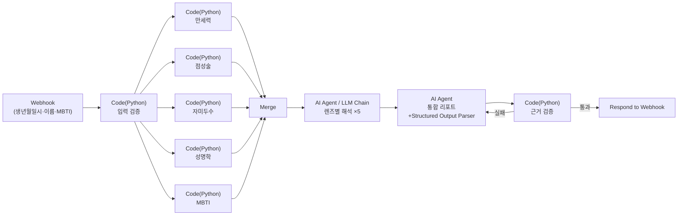
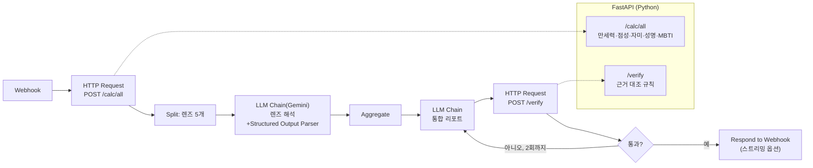
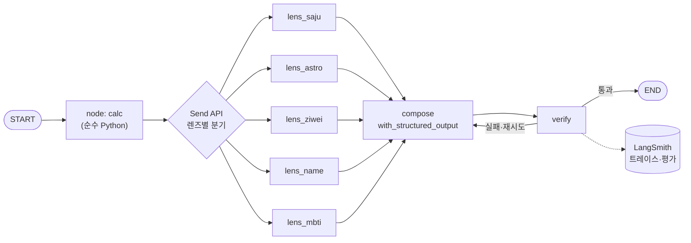
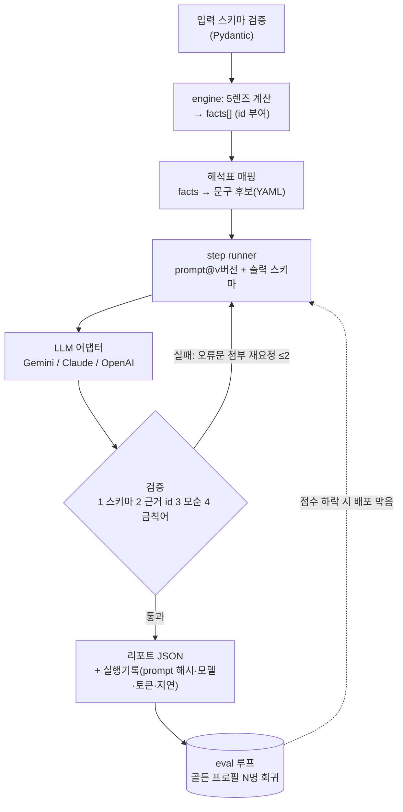
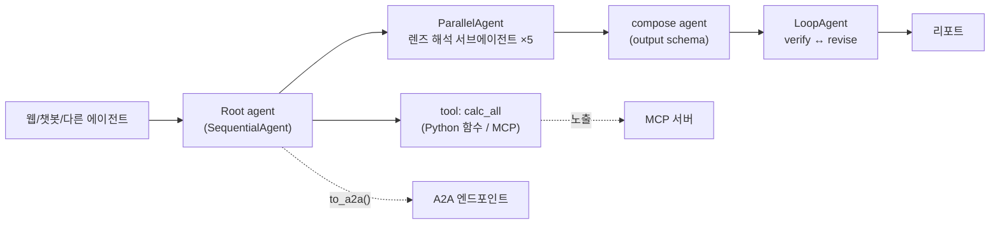
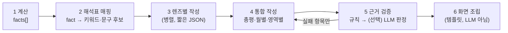
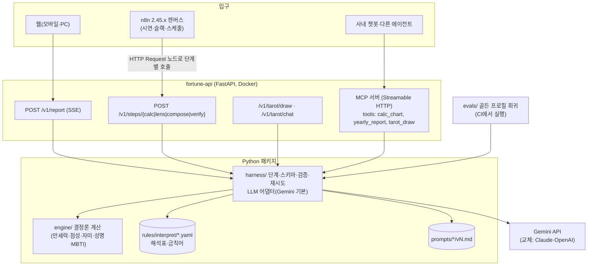
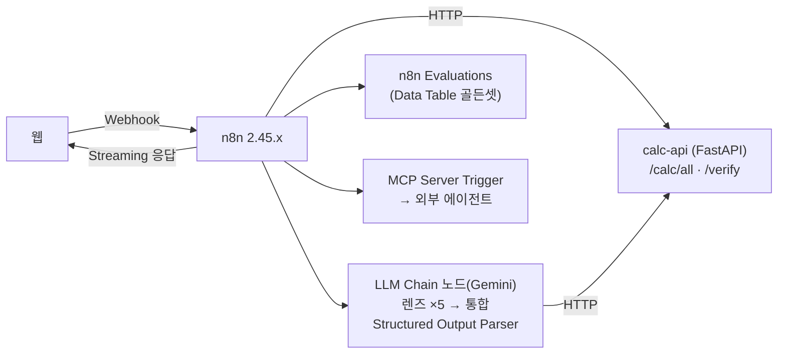

# 05. 에이전트 구조 — n8n · LangChain · 하네스 · 에이전트 SDK 비교

- 작성: 2026-10-30 (모든 출처 확인일은 따로 적지 않으면 2026-10-30)
- 범위: "2027 신년운세" PoC(사주 입구 5렌즈 리포트 + 타로 대화)의 **LLM·워크플로 구조**. 만세력·점성술 계산 정확도 자체는 다른 조사 문서 담당.
- 표기: **미확인** = 출처로 확인 못 함. **추정** = 근거를 밝힌 내 계산·판단(사실 아님).

---

## 0. 한 장 요약

- 공개 사례들이 같은 결론에 도달해 있다: **"계산은 코드, 해석은 LLM, LLM 문장은 계산 사실에만 기대게 한다."** LLM 단독 계산은 절기 경계·시주에서 30~65% 정도만 맞는다는 비공식 벤치마크도 있다(§1.4).
- **추천 1안**: Python(FastAPI) 안에 "운세 엔진(계산) + 하네스(단계·스키마·검증·재시도·평가·프롬프트 버전)"를 원본으로 두고, **n8n은 같은 단계 API를 노드로 이어 붙인 시연·연결용 흐름**으로 둔다. 웹은 FastAPI를 직접 호출(스트리밍), 독립 에이전트는 같은 패키지를 MCP 서버로 노출.
- **대안 2안**: n8n이 흐름과 LLM 호출을 모두 맡고 FastAPI는 계산·검증만. 만들기·보여주기는 가장 쉽지만 품질 제어·평가·버전 관리가 약하다.
- n8n 주의: **3.0 베타가 2026-10-27 나왔고 정식은 12월 초 예정**. 2.x의 Python Code 노드는 별도 runner 컨테이너가 필요하고 import 허용 설정 버그 보고가 있다. → 계산을 n8n Code 노드에 넣지 말 것.
- 라이선스: n8n Sustainable Use License는 **사내 업무 목적(백엔드에서 n8n을 돌리고 사용자가 결과만 보는 형태)**은 허용. 고객이 n8n 워크플로를 직접 만들게 하면 안 됨. 회사 맥은 Docker Desktop 대신 **Colima(MIT)**.

---

## 1. 공개 사례

### 1.1 강의: 인프런 「전문 사주팔자 AI Agent 만들기 - 풀스택 n8n+Python」 (소개 페이지 수준)

| 항목 | 소개 페이지·공개 Q&A에 적힌 것 |
|---|---|
| 스택 | n8n 2.x(Docker), Python task runner(Python Code 노드에 도메인 로직), Docker 기반 차트 API, 배포 섹션 포함 |
| 구조 | 13개 전문 에이전트가 협업해 리포트 생성. 에이전트 이름 전체 목록은 페이지에 없음(이름 분석·인생 타임라인·직업 추천·관계 프로필·위험 탐지 등 영역만 보임) |
| 렌즈 | 만세력·사주팔자·점성술·자미두수·성명학·MBTI |
| 출력 | 리포트, 7역량 차트·대시보드 |
| 분량 | 30강, 약 9시간 6분, 중급 이상 |
| 강사 답변(2026-05-26) | LangChain/LangGraph로 100% 코드 구현도 가능. n8n은 파이프라인을 빨리 시험하는 용도. **만세력은 정확도가 핵심이라 코드로 작성**, 나머지는 n8n 노드. n8n은 프론트가 없어 프론트는 코드로 |
| 강사 답변(2026-05-02) | "모든 예외와 지역별 시간대, 절기 보정, 출생지 기준의 정밀 계산까지 반영한 100% 완성형 사주 엔진을 목표로 한 코드는 아닙니다." 입력 시각을 Asia/Seoul로 해석 |

한계(추정): 13개 에이전트를 n8n 캔버스에 펼치면 시연엔 좋지만, 각 단계의 스키마 검증·회귀 평가·프롬프트 버전 관리는 n8n 기본 기능 밖이라 직접 붙여야 한다. 강의 내용 자체는 열람하지 않았고 복제하지 않는다.

출처: https://www.inflearn.com/course/creating-a-professio · https://www.inflearn.com/community/questions/1818202 · https://www.inflearn.com/course/creating-a-professio/inquiries

### 1.2 n8n 공식 템플릿 갤러리

| 템플릿 | 구조 | 한계 |
|---|---|---|
| #21165 AI astrology reader (n8n chat·Telegram) | 라우팅 에이전트가 질문을 전문 에이전트(서양·베다 점성술, 수비학, 타로·주역, Human Design, 중국 BaZi)로 넘김. 계산은 외부 RoxyAPI 도구 호출 | 유료 외부 API(RoxyAPI) 의존. 한국식 사주·자미두수·성명학 없음 |
| RoxyAPI의 같은 계열 템플릿 설명 | 트리거(웹챗·Telegram·매일 7시 스케줄) → 메시지 정규화 → 저장된 출생 프로필 로드(n8n Data Table) → 리더 에이전트 → 6개 전문가. `aiProvider` 설정 하나로 Gemini/OpenAI/Anthropic 선택. n8n 2.x + Data Tables 필요, MIT | 대화 메모리는 창 길이 기반(운영은 DB 메모리로 바꾸라고 안내) |
| #6061 iMessage 타로 (GPT + Blooio) | Webhook → 자기 메시지 무시 → If 분기(사진이면 이미지 인식) → OpenAI "Mystic Tarot Reader" 페르소나 → HTTP로 답장 | **가상 카드 뽑기를 코드 난수로 하는지 LLM이 고르는지 페이지에 없음(미확인)**. 대화 기록 미보존으로 보임 |

출처: https://n8n.io/workflows/21165 · https://roxyapi.com/templates/n8n-astrology-ai-agent · https://n8n.io/workflows/6061-ai-powered-tarot-readings-via-imessage-with-gpt-and-blooio/

갤러리에서 **한국 사주·자미두수·신년운세 전용 공식 템플릿은 찾지 못했다**(검색 범위 내).

### 1.3 GitHub 저장소 (별 수·라이선스는 2026-10-30 GitHub API 기준)

| 저장소 | 언어/라이선스 | 구조 요약 | 눈여겨볼 점 / 한계 |
|---|---|---|---|
| [ziweiknows/ziwei-chat](https://github.com/ziweiknows/ziwei-chat) | TS / Apache-2.0 | 출생정보 → iztro 결정론 명반 → 사실·질문 라우팅 → 주제 워크플로 + 지식 검색 → 답변 → **critic 검토와 근거 패널** | "결정론 도구가 준 정보만 사용자 명반 사실로 말할 수 있다", 지식베이스는 해석용이지 사실 보충용 아님. 모델 미설정 시 그럴듯한 분석을 지어내지 않음. 우리 "근거 검증" 단계의 좋은 참고 |
| [dzcmemory-web/bazi-ziwei-skills](https://github.com/dzcmemory-web/bazi-ziwei-skills) | TS / MIT | 排盘(mingpan+iztro) → 텍스트 명반 → LLM 분석 → (선택) HTML 템플릿 | "LLM은 분석만, 排盘과 HTML은 하지 않는다". 팔자·자미 두 체계를 교차 대조하는 단계 |
| [FANzR-arch/Numerologist_skills](https://github.com/FANzR-arch/Numerologist_skills) | Python / 라이선스 표기 없음 ★1.5k | SKILL.md(흐름·출력 제약) + references(규칙·용어·口径) + scripts(고정 계산 CLI) | 원칙: 정보 부족하면 먼저 묻기, 결정론 계산은 외부로, 유파·규칙을 먼저 밝히고 결론 |
| [DestinyLinker/MingLi-Bench](https://github.com/DestinyLinker/MingLi-Bench) | Python / MIT ★2.5k | 실제 대회 문항 160개(2022~2025) 객관식, `--astro`로 iztro 명반을 미리 계산해 주입 | **"계산 정확도"와 "해석 추론"을 분리해서 평가**하는 방식이 우리 eval 설계에 그대로 쓸 만함 |
| [imly-sudo/bazi-llm-benchmark](https://github.com/imly-sudo/bazi-llm-benchmark) | Python / MIT ★0 | 절기 경계 ±4시간 50개 샘플로 LLM 단독 排盘 정확도 측정 | 7개 모델 30~65%라고 적었으나 저자 스스로 "추정치, 자동 벤치 완료 전"이라 밝힘 → 참고만 |
| [hhszzzz/taibu](https://github.com/hhszzzz/taibu) | TS / 라이선스 NOASSERTION ★706 | 다체계(팔자·자미·타로·MBTI 등) 웹 + 에이전트 대화 + **MCP 서버** | 계산 도구를 MCP로 내놓아 다른 에이전트가 호출 — "웹 밖 독립 에이전트" 형태의 사례 |
| [Brhiza/mingyu](https://github.com/Brhiza/mingyu) | TS / **AGPL-3.0** | 排盘 → 구조화 프롬프트·데이터 출력, 공개 API·MCP(stdio·Streamable HTTP)·skill | LLM 호출 대신 "LLM에 넘길 프롬프트"를 만드는 설계. AGPL이라 사내 코드에 섞지 말 것 |
| [RoxyAPI/astrology-ai-chatbot](https://github.com/RoxyAPI/astrology-ai-chatbot) | TS / MIT | 사용자 메시지 → LLM이 도구 선택 → MCP로 RoxyAPI 호출 → 실데이터 → LLM 해석 → 스트리밍. 도구 이름별 위젯 렌더 | 계산이 유료 외부 API. 자유 도구 선택(에이전트형)이라 리포트 일관성은 약함(추정) |
| [imgompanda/drsaju-opensource](https://github.com/imgompanda/drsaju-opensource) | TS / MIT | Next.js + Vercel AI SDK + **Gemini**. 만세력(manseryeok, 진태양시 보정) → AI 종합·월별 운세 → PDF | "계산은 코드, 해석은 AI". 한국어 사주 + Gemini 조합의 가장 가까운 사례. 검증 단계 설명은 README에 없음 |
| [be-realdeveloper/saju](https://github.com/be-realdeveloper/saju) | JS / MIT | Claude Code 스킬. 만세력 엔진 → 18장 풀이 → 상담 모드. `references/interpretation.md`(일간·십신·12운성·신살 해석 사전) | **"해석표(근거 사전)"를 따로 두어 풀이 일관성을 잡는** 패턴 |
| [adminhelper/saju-engine](https://github.com/adminhelper/saju-engine) | JS / NOASSERTION | 결정론 만세력 + MCP 서버 + 역술가 페르소나 skill, 골든 회귀 테스트 | 신뢰도(상/중/하) 표기, 전문용어를 "쉽게 말하면…"으로 번역 |
| [Seaual/Bazi_LLM](https://github.com/Seaual/Bazi_LLM) | / 표기 없음 | FastAPI + Vue + LangChain + lunar-python, **프롬프트를 LangSmith에서 관리** | 단계별(연·대운·월) 프롬프트 체인 |
| [InoneSummer/saju_harness_practice](https://github.com/InoneSummer/saju_harness_practice) | Python / MIT | "하네스 엔지니어링 따라하기" 교육용, harness/core 규칙·scripts(checkpoint·rollback) + apps/saju | 하네스를 "코딩 에이전트용 작업 환경" 의미로 쓴 국내 사례 |

계산 라이브러리 참고(라이선스 주의): [SylarLong/iztro](https://github.com/SylarLong/iztro)(자미, TS, MIT), [spyfree/iztro-py](https://github.com/spyfree/iztro-py)(Python, MIT), [6tail/lunar-python](https://github.com/6tail/lunar-python)(MIT), [0ssw1/sajupy](https://github.com/0ssw1/sajupy)(MIT), [golbin/ssaju](https://github.com/golbin/ssaju)(TS, MIT), [g-battaglia/kerykeion](https://github.com/g-battaglia/kerykeion)(점성술, **AGPL-3.0**). 정확도 검증은 다른 조사 문서 몫.

### 1.4 사례에서 뽑은 공통 패턴과 한계

1. **결정론 계산 분리**: 거의 모든 진지한 사례가 LLM에게 排盘을 시키지 않는다(ziwei-chat, bazi-ziwei-skills, saju, drsaju, MingLi-Bench `--astro`).
2. **해석 사전(근거표)**: 계산 결과 → 고정된 해석 문구표 → LLM이 문장으로 엮음(be-realdeveloper/saju, Numerologist_skills references).
3. **근거 노출·critic**: 답변 옆에 어떤 사실을 썼는지 보여주고, 사실 밖 주장을 거른다(ziwei-chat).
4. **MCP로 계산 도구 공개**: taibu, mingyu, saju-engine, RoxyAPI — "독립 에이전트화"의 현실적인 첫 단계.
5. 공통 한계: (a) **평가셋이 거의 없다**(MingLi-Bench 정도), (b) 리포트형 사례는 대부분 "한 번 생성"이고 검증·재시도 루프 설명이 없다, (c) 여러 사람에게 똑같이 들어맞는 문장(바넘 효과)을 막는 장치를 명시한 곳은 찾지 못함.

---

## 2. 구현 방식 5가지 비교

공통 흐름(사주 입구): 입력 → 5렌즈 계산 → 렌즈별 해석 → 통합(총평·월별·영역별) → 근거 검증 → 화면. 타로 입구: 질문 → 카드 뽑기(코드 난수) → 대화형 풀이.

### (a) n8n 2.x 단독



- Python Code 노드는 2.0부터 **native Python(task runner)만** 지원(Pyodide 제거), `_items`/`_item` 외 n8n 내장 변수 없음, stdlib·외부 모듈 import 기본 차단(허용 목록 필요), 외부 패키지는 `n8nio/runners` 이미지를 직접 확장해야 함. 출처: https://docs.n8n.io/integrations/builtin/core-nodes/n8n-nodes-base.code/ · https://docs.n8n.io/hosting/configuration/task-runners/
- 2.0부터 기본 n8n 이미지에 external runner가 없어 `n8nio/runners` 사이드카가 필요. 출처: https://docs.n8n.io/2-0-breaking-changes
- 2.0.2에서 `N8N_RUNNERS_STDLIB_ALLOW=*`가 무시돼 모든 import가 막힌다는 이슈(중복 처리로 닫힘, 해결 여부는 이 페이지로는 미확인). 출처: https://github.com/n8n-io/n8n/issues/23175
- 3.0에서 Code 노드 기본 타임아웃 5분→1분. 출처: https://docs.n8n.io/changelog/v30-breaking-changes
- n8n 문서 스스로 "에이전트에서 구조화 출력 파싱은 자주 불안정, 별도 LLM Chain으로 파싱하라"고 안내. 출처: https://docs.n8n.io/integrations/builtin/cluster-nodes/sub-nodes/n8n-nodes-langchain.outputparserstructured/common-issues/

### (b) n8n 오케스트레이션 + 외부 FastAPI 계산 API



- n8n 템플릿 #21165가 이 형태(계산은 외부 API, n8n은 흐름·LLM). 계산은 pytest로 따로 검증 가능.
- 스트리밍: Webhook 응답 모드 "Streaming" + AI Agent 노드 "Enable streaming"을 둘 다 켜야 한다는 설명은 **제3자 가이드 기준**(공식 문서로는 미확인). 출처: https://n8nchatui.com/blog/n8n-chat-streaming-guide

### (c) LangChain / LangGraph (Python 코드)



- LangGraph = "장시간·상태 있는 에이전트를 위한 저수준 오케스트레이션 프레임워크·런타임", 결정론 단계와 LLM 단계를 한 그래프에 섞을 수 있음. 지속 실행·스트리밍·사람 개입·메모리 지원. LangChain 에이전트(`create_agent`)는 그 위의 상위 레이어. LangSmith로 트레이스·평가. 출처: https://docs.langchain.com/oss/python/langgraph/overview
- 최신 릴리스 1.2.18 (2026-10-26, GitHub releases).
- 그래프 시각화는 가능하지만 n8n 캔버스만큼 비개발자 시연용은 아님(추정).

### (d) 직접 짠 Python 하네스



- 비슷한 기능을 라이브러리로 얻을 수 있다: Pydantic AI는 Pydantic 모델을 `output_type`으로 받아 검증하고, `output_validator`에서 `ModelRetry`를 던지면 오류를 모델에 돌려 재시도(기본 1회, 설정 가능), 부분 검증 스트리밍(`stream_output`) 지원, Gemini·Anthropic·OpenAI 사용. 출처: https://pydantic.dev/docs/ai/core-concepts/output/
- Gemini 구조화 출력: JSON Schema 지정 가능, `minLength`·`maxLength` 등 일부 제약은 **무시되므로 클라이언트에서 검사**, 스트리밍 조각은 이어 붙이면 완성 JSON. "문법상 맞는 JSON이어도 값은 앱에서 항상 검증하라." 출처: https://ai.google.dev/gemini-api/docs/structured-output
- Anthropic은 "도구·프레임워크보다 LLM API를 직접 호출하는 단순한 구성부터 시작하라, 복잡성은 결과가 나아질 때만"을 권한다. 출처: https://www.anthropic.com/engineering/building-effective-agents (2024-12-19)

### (e) 에이전트 SDK (Claude Agent SDK / Google ADK)



- Google ADK: Python·TS·Go·Java·Kotlin, Gemini 외 Claude·OpenAI·Ollama·LiteLLM 어댑터, Sequential/Loop/Parallel 워크플로 에이전트와 그래프 워크플로(ADK 2.0), A2A 노출·소비, MCP 도구·에이전트를 MCP 서버로, 평가 기능(기준·사용자 시뮬레이션·커스텀 지표), Cloud Run/GKE 또는 자체 인프라 배포. `to_a2a(root_agent)`로 A2A 앱 생성. 출처: https://adk.dev/ · https://adk.dev/a2a/quickstart-exposing/ . adk-python 최신 v2.13.0(2026-10-23).
- Claude Agent SDK: Claude Code의 도구·에이전트 루프·컨텍스트 관리를 Python/TS 라이브러리로 제공(내장 도구=파일·명령·웹 검색, 훅, 서브에이전트, MCP, 세션). Anthropic 상용 약관 적용. Claude 모델 전제라 **Gemini로 시작하는 이번 조건과 맞지 않음**. 파일·명령 실행이 중심인 범용 에이전트라 "정해진 리포트 생성"에는 과함(추정). 출처: https://code.claude.com/docs/en/agent-sdk/overview

### 2.1 비교표 (◎ 아주 좋음 ○ 좋음 △ 보통 × 약함 — 판단은 위 출처를 근거로 한 추정)

| 기준 | (a) n8n 단독 | (b) n8n+FastAPI | (c) LangGraph | (d) 직접 하네스 | (e) ADK / Claude SDK |
|---|---|---|---|---|---|
| 만들기 쉬움 | ○ 첫 시연 빠름. 단 Python runner 설정이 걸림돌 | ○ | △ 개념(상태·노드·리듀서) 학습 | △ 직접 짜야 함(Pydantic AI 쓰면 ○) | △ ADK 개념 학습 / Claude SDK는 용도 불일치 |
| 시연 가시성 | ◎ 캔버스·실행 이력 | ◎ | △ 그래프 그림·LangSmith 트레이스 | × 직접 화면 필요 | ○ ADK 개발 UI(미확인 세부) |
| 품질 제어(구조화·검증) | △ 파서 불안정 경고(공식) | ○ 검증은 Python | ○ | ◎ 단계마다 스키마·검증·재시도 | ○ |
| 테스트·평가 | × Evaluations 기능 있으나 데이터는 Data Table/Sheets, 커뮤니티판 제한은 미확인 | △ 계산은 pytest, LLM 단계는 n8n 안 | ○ LangSmith(유료 SaaS 가능성, 요금 미확인) | ◎ pytest + 자체 eval | ○ ADK eval 내장 |
| 비용·지연 | 같음(LLM 호출 수가 좌우). n8n 노드 오버헤드는 작음(추정) | 같음 | 같음 | 같음 + 캐시·병렬 직접 조절 쉬움 | 같음 |
| 운영(배포·버전) | △ 워크플로 JSON. Git 버전관리·환경 분리는 커뮤니티판 미포함 | △ 위와 같음 + API 이미지 | ○ 코드·Git | ◎ 코드·Git·프롬프트 파일 버전 | ○ |
| 독립 에이전트화(MCP/A2A) | ○ MCP Server Trigger(SSE·Streamable HTTP, stdio 불가) | ○ 같음 + FastAPI를 MCP로 | ○ 코드로 MCP 서버 래핑 | ◎ 같은 패키지를 MCP 서버로 | ◎ ADK `to_a2a`, MCP |
| 회사 제약 | n8n self-host 필요(Docker), SUL 조건 | 같음 | 없음(LangSmith 쓰면 외부 전송) | 없음 | ADK 오픈소스 / Claude SDK는 Anthropic API 키 |

비교 근거 출처: n8n 커뮤니티판 미포함 기능(환경, 외부 비밀, Git 버전관리, SSO 등) https://docs.n8n.io/hosting/community-edition-features/ · n8n 평가 기능 https://docs.n8n.io/advanced-ai/evaluations/metric-based-evaluations · MCP Server Trigger https://docs.n8n.io/integrations/builtin/core-nodes/n8n-nodes-langchain.mcptrigger/ . n8n Evaluations가 커뮤니티판에서 워크플로 1개로 제한된다는 말은 **포럼 사용자 글 하나뿐(미확인)**: https://community.n8n.io/t/new-n8n-builders-berlin-session-recording-ai-evaluations/220952

### 2.2 n8n 버전·라이선스·실행 환경 확인 사항

- **버전 상황(2026-10-30)**: 최신 정식 `n8n@2.45.6`(10-29), `n8n@3.0.0` 베타 10-27, 3.x 정식은 12월 초 예정. 정식 후 2.x는 12개월간 보안·치명 버그만 수정, 1.x 지원은 2026-12-31 종료. 3.0에서 npm/npx 설치 중단(Docker 전용), AI Agent 노드 v1과 구 모드(ReAct·Conversational 등) 제거 — Tools Agent는 동작 유지. 출처: https://github.com/n8n-io/n8n/releases · https://blog.n8n.io/introducing-n8n-v3 · https://docs.n8n.io/changelog/v30-breaking-changes
  → PoC는 `n8nio/n8n:2.45.x`로 **버전 고정**, AI Agent는 최신 버전(Tools Agent)만 사용, 12월 이후 3.x 이전 계획.
- **Sustainable Use License(사내 사용)**: "internal business purpose"는 조직·제품 안에서 n8n을 쓰는 것이며 **외부 사람이 워크플로 결과를 보거나 받아도 포함**. 허용: 내 제품 뒤에서 n8n이 돌고 사용자는 자동화를 쓰기만 하는 것, 백엔드만 n8n과 통신하는 구성. 금지: n8n을 서비스로 호스팅해 고객이 워크플로를 만들게 하는 것, 임베드된 워크플로 빌더, 라이선스 키가 필요한 엔터프라이즈 기능을 키 없이 쓰는 것. 애매하면 license@n8n.io. 출처: https://docs.n8n.io/n8n-community-license/community-license/license-faq · https://docs.n8n.io/n8n-community-license/sustainable-use-license
  → 사내 PoC 웹이 백엔드에서 n8n을 호출하는 구조는 허용 범위로 읽힌다. 다만 **한화생명 법무 검토 여부는 미확인**이므로 정식 출시 전 확인 권장. GitHub API상 n8n 저장소 라이선스는 NOASSERTION(표준 SPDX 아님).
- **Docker Desktop**: 무료 소규모 사업자 조건이 "직원 250명 미만 AND 연매출 1천만 달러 미만", 대규모 조직의 업무용은 유료 플랜 대상. 출처: https://docs.docker.com/subscription/desktop-license/ → 회사 맥은 **Colima(MIT, `brew install colima`, `colima start`)**. 출처: https://github.com/abiosoft/colima . Colima 위 docker compose 동작은 일반적 사용 예가 많지만 n8n+runners 조합은 **이 맥에서 직접 확인 전(미확인)**.

---

## 3. "그럴듯한 운세"를 위한 LLM 단계 설계

### 3.1 렌즈별 전문 에이전트 vs 단일 통합 프롬프트

| | 렌즈별 단계(병렬 5회 + 통합 1회) | 단일 통합 프롬프트(1회) |
|---|---|---|
| 품질 | 렌즈마다 짧은 해석표·스키마 → 근거가 촘촘 | 긴 입력 속에서 렌즈 간 섞임·누락 위험(추정) |
| 지연 | 병렬이면 "가장 느린 렌즈 + 통합" | 출력이 길어 한 번이 김 |
| 비용 | 호출 6~8회 | 1~2회 |
| 디버깅·평가 | 렌즈 단위로 회귀 가능 | 어려움 |

추천: **"자율 에이전트 13개"가 아니라 "정해진 단계(workflow)"**. Anthropic 분류로는 prompt chaining + parallelization(sectioning) + evaluator-optimizer 조합이다(출처: https://www.anthropic.com/engineering/building-effective-agents). 신년운세 리포트는 매번 같은 목차를 채우는 일이라 LLM이 다음 행동을 스스로 고를 이유가 없다. **타로 대화**만 대화형(메모리 + 도구 1~2개) 에이전트가 맞다.

### 3.2 단계



1. **계산 → facts**: 모든 계산 결과를 `{"id":"saju.day_master","lens":"saju","key":"일간","value":"甲","polarity":null}`처럼 id 붙은 사실 목록으로 만든다. 월별은 `saju.2027-03.month_pillar` 같은 id.
2. **해석표 매핑**: `rules/interpret/saju.yaml` 같은 사람이 검수한 표에서 fact별 키워드·톤(긍정/주의/중립)·금지 표현을 뽑아 LLM에 함께 준다(be-realdeveloper/saju의 근거 사전 패턴). LLM은 이 표 밖의 성격 판정을 새로 만들지 않는다.
3. **렌즈별 작성**: 렌즈당 3~5개 짧은 주장 + 각 주장의 `evidence` fact id.
4. **통합 작성**: 렌즈 결과만 입력(원본 계산 전체를 다시 넣지 않음). 렌즈 간 충돌은 "A는 ~, B는 ~"로 둘 다 보여주게 지시(bazi-ziwei-skills의 교차 대조).
5. **근거 검증**: 아래 §3.4.
6. **화면 조립**: 차트·표·월별 그래프는 facts로 코드가 그린다. LLM 출력은 문장 칸만 채운다(bazi-ziwei-skills "HTML은 고정 템플릿").

### 3.3 출력 JSON 스키마 예시 (통합 단계)

```json
{
  "schema_version": "report.v1",
  "prompt_version": "compose@2026-11-03.a",
  "headline": "string, 40자 이내",
  "overall": {
    "summary": "string, 3~4문장",
    "claims": [
      {"text": "string", "evidence": ["saju.day_master", "ziwei.ming_palace.main_star"], "tone": "positive|caution|neutral", "confidence": "high|mid|low"}
    ]
  },
  "months": [
    {"month": "2027-01", "keyword": "string, 8자 이내", "text": "string, 2문장", "evidence": ["saju.2027-01.month_pillar"], "tone": "caution"}
  ],
  "areas": {
    "work":  {"text": "string", "evidence": ["..."]},
    "money": {"text": "string", "evidence": ["..."]},
    "love":  {"text": "string", "evidence": ["..."]},
    "health":{"text": "string", "evidence": ["..."], "disclaimer_required": true}
  },
  "lens_notes": [
    {"lens": "saju|astro|ziwei|name|mbti", "text": "string", "evidence": ["..."]}
  ],
  "conflicts": [
    {"between": ["saju", "astro"], "text": "string"}
  ]
}
```

- `months`는 정확히 12개(Gemini는 `minItems`/`maxItems`를 지킨다고 문서에 있음), 글자 수 제한은 Gemini가 무시하므로 Pydantic에서 검사.

### 3.4 근거 검증(할루시네이션 방지)

순서대로, 싼 것부터:

1. **스키마**: Pydantic 통과, 월 12개, 글자 수.
2. **근거 존재**: 모든 `evidence` id가 이번 facts에 있는가. 근거 없는 주장 = 삭제 또는 재작성 요청(Anthropic "인용으로 검증, 근거를 못 찾으면 주장 철회" 기법과 같은 원리. 출처: https://platform.claude.com/docs/en/test-and-evaluate/strengthen-guardrails/reduce-hallucinations).
3. **값 모순(규칙)**: 해석표에 fact별 "말하면 안 되는 방향"을 둔다. 예: `saju.element.fire = 0` → 본문에 "불(화) 기운이 강" 류 표현 금지. 오행·별자리·MBTI 글자 등 **텍스트에 등장한 용어를 사전으로 추출해 facts 값과 대조**(정규식·용어 사전, 추정 설계).
4. **금칙어·민감 영역**: 단정적 예측("반드시", "사고가 난다"), 건강·투자·법률 단정, 사망·질병 → 거절 또는 완화. 사내 PoC라도 보험사 브랜드 리스크가 있으므로 엄격히(추정).
5. **(선택) LLM 판정**: 작은 모델로 "이 문장이 주어진 facts와 모순되는가"만 예/아니오 판정. Fowler 분류의 "추론형 센서" — 느리고 매번 결과가 달라질 수 있으므로 규칙 검사 뒤에만. 출처: https://martinfowler.com/articles/harness-engineering.html
6. **재시도**: 실패 항목과 이유를 붙여 해당 섹션만 재작성, 최대 2회. 그래도 실패하면 그 섹션은 해석표 기본 문구로 대체(빈칸보다 낫다).

추가: **바넘 문장 감지** — 서로 다른 골든 프로필 리포트끼리 문장 유사도가 높으면 "누구에게나 맞는 말"로 보고 eval 점수에서 감점(추정 설계, 공개 사례에서는 못 찾음).

### 3.5 응답 시간과 스트리밍 UI

- 계산은 밀리초~1초 수준(추정). LLM이 지연의 대부분.
- 추정 예: 렌즈 5개 병렬(각 출력 ~400토큰) + 통합(출력 ~2,500토큰) + 규칙 검증. Flash 계열 기준 대략 10~25초(**추정, 실측 필요**). 비용은 리포트당 입력 ~1만·출력 ~5천 토큰이면 Gemini 3.8 Flash 표준가($0.75/$3.75 per 1M, 2027-01-01부터 인상 예고) 기준 약 $0.03(추정). 출처(가격): https://ai.google.dev/gemini-api/docs/pricing
- 화면 순서(SSE):
  1. 0초: 입력 즉시 **계산 결과(사주 원국표·오행 그래프·별자리·MBTI)** 표시 — LLM 없이 의미 있는 화면.
  2. 렌즈 해석이 끝나는 대로 렌즈 카드를 하나씩 채움.
  3. 통합 리포트는 섹션 단위로 "검증 통과 후" 표시. 토큰 단위 스트리밍은 검증 전 문장을 보여주게 되므로 **섹션 단위 스트리밍**을 권장(추정 판단). Gemini·Pydantic AI 모두 부분 JSON 스트리밍 지원.
- 같은 입력(생년월일시+이름+MBTI+프롬프트 버전) 결과는 캐시. 사내 시연에서 같은 사람을 여러 번 넣는 경우가 많다.

### 3.6 타로 입구

- 카드 뽑기는 **코드 난수**(`secrets.SystemRandom`), 뽑은 카드·정역·배열 위치를 facts로 기록. LLM이 카드를 고르지 않는다(공개 템플릿 #6061은 이 부분이 미확인이라 참고 안 함).
- 카드 의미표(78장 × 정/역)를 YAML로 두고 같은 근거 검증 적용. 대화는 세션 메모리 + "카드 다시 보기" 도구 정도.

---

## 4. 하네스 엔지니어링 — 2025~2026년의 쓰임 (짧게)

| 출처 | 날짜 | 정의·쓰임 |
|---|---|---|
| Mitchell Hashimoto, "My AI Adoption Journey" Step 5 | 2026-02-05 | "에이전트가 실수할 때마다, 다시는 그 실수를 하지 않도록 해결책을 설계하는 것"을 harness engineering이라 부른다고 씀(업계 표준 이름인지 본인도 확신 못함). https://mitchellh.com/writing/my-ai-adoption-journey |
| OpenAI, "Harness engineering: leveraging Codex in an agent-first world" (Ryan Lopopolo) | 2026-02-11 | Codex 에이전트가 코드를 쓰고 엔지니어는 환경·의도·피드백 루프를 설계. **원문은 403으로 직접 열람 실패(미확인)** — 날짜·저자·요지는 InfoQ 등 2차 출처 기준. https://openai.com/index/harness-engineering/ · https://www.infoq.com/news/2026/02/openai-harness-engineering-codex |
| Birgitta Böckeler (Thoughtworks), martinfowler.com | 2026-04-02 | 하네스 = "AI 에이전트에서 모델 자체를 뺀 모든 것". **가이드(feedforward, 행동 전 유도)**와 **센서(feedback, 행동 후 관찰·자기 수정)**, 각각 **계산형(테스트·린터, 빠르고 결정론)**과 **추론형(LLM 판정, 느리고 결과 변동)**. https://martinfowler.com/articles/harness-engineering.html |
| Anthropic, "Effective harnesses for long-running agents" | 2025-11-26 | 정식 정의 없이, 모델을 에이전트로 돌리는 주변 시스템(도구·컨텍스트 관리·프롬프트) 의미로 사용. Claude Agent SDK를 "범용 에이전트 하네스"라 표현. https://www.anthropic.com/engineering/effective-harnesses-for-long-running-agents |

정리: 원래는 **코딩 에이전트** 맥락의 말이다. 이 문서에서는 같은 생각을 **제품 안 LLM 파이프라인**에 적용해 "단계별 출력 스키마(가이드) + 계산형 검증·LLM 판정(센서) + 재시도 + 평가 회귀 + 프롬프트 버전"을 하네스라 부른다. 이 확장 용법은 위 출처의 정의가 아니라 이 문서의 선택이다.

---

## 5. 추천 아키텍처

### 5.1 추천 1안 — "Python 하네스가 원본, n8n은 시연·연결 껍데기"



왜 이 구성인가:
- **정확도·품질의 원본이 코드 한 곳**에 있어 pytest·eval·Git 버전 관리가 된다(§2.1 (d)).
- **n8n 시연 가시성**은 유지: 시연용 워크플로가 `/v1/steps/calc → lens(×5 병렬) → compose → verify`를 노드로 하나씩 호출하므로 캔버스에서 단계가 보이고 실행 이력에 각 단계 JSON이 남는다. n8n Python Code 노드·runner 사이드카가 필요 없다(§2 (a)의 설정 문제 회피).
- n8n은 "있어도 되고 없어도 되는" 위치 → 3.0 전환·라이선스 판단이 서비스 본체를 막지 않는다.
- **웹 밖 독립화**: 같은 하네스를 MCP 서버로 노출(공식 MCP Python SDK, MIT: https://github.com/modelcontextprotocol/python-sdk). A2A가 필요해지면 하네스를 도구로 감싼 ADK 루트 에이전트를 `to_a2a()`로 노출(§2 (e)).
- LLM 교체: 하네스 안 어댑터 하나(직접 구현 또는 Pydantic AI)로 Gemini → Claude·OpenAI.

중복 위험: 리포트 흐름이 FastAPI(`/v1/report`)와 n8n 시연 흐름 두 곳에 생긴다. 규칙: **n8n은 단계 API만 호출하고 분기·재시도 로직을 새로 만들지 않는다**(재시도는 `/verify`가 돌려준 결과대로 한 번만). 차이가 생기면 FastAPI가 정답.

폴더 구조:

```text
fortune2027/
├─ engine/              # 순수 함수 계산. LLM 금지. pytest 필수
│  ├─ manse.py  astro.py  ziwei.py  name.py  mbti.py
│  └─ facts.py          # 계산 결과 → id 붙은 facts[]
├─ harness/
│  ├─ schemas/          # Pydantic: LensOutput, Report, TarotReading
│  ├─ steps/            # calc.py lens.py compose.py verify.py tarot.py
│  ├─ llm/              # adapter.py (gemini.py, anthropic.py, openai.py)
│  ├─ validators/       # evidence.py contradiction.py banned.py
│  └─ runner.py         # 재시도·타임아웃·실행기록(prompt 해시·모델·토큰·ms)
├─ prompts/             # lens_saju/v3.md, compose/v5.md ... (파일=버전)
├─ rules/interpret/     # saju.yaml astro.yaml ziwei.yaml name.yaml mbti.yaml tarot.yaml banned.yaml
├─ api/                 # FastAPI 앱, SSE, /v1/steps/*
├─ mcp_server/          # MCP 노출
├─ evals/
│  ├─ golden/           # 골든 프로필 30~50명(가상 인물) + 기대 facts
│  ├─ metrics.py        # 스키마 통과율, 근거 커버리지, 모순 수, 금칙어, 바넘 유사도
│  └─ run_eval.py
├─ n8n/workflows/       # 시연 워크플로 JSON 내보내기(커뮤니티판엔 Git 연동이 없어 수동 커밋)
├─ web/                 # 프론트
├─ tests/
├─ Dockerfile
└─ docker-compose.yml
```

로컬 실행(Colima):

```bash
brew install colima docker docker-compose   # Docker Desktop 대신
colima start --cpu 4 --memory 6             # 수치는 예시
cp .env.example .env                        # GEMINI_API_KEY 등
docker compose up -d --build
# API  http://localhost:8000/docs
# n8n  http://localhost:5678  (n8n/workflows/*.json 가져오기)
uv run pytest && uv run python -m evals.run_eval --suite golden
```

```yaml
# docker-compose.yml (요지)
services:
  api:
    build: .
    env_file: .env
    ports: ["8000:8000"]
  n8n:
    image: n8nio/n8n:2.45.6          # 버전 고정 (3.x 정식 후 이전 검토)
    ports: ["5678:5678"]
    environment:
      - GENERIC_TIMEZONE=Asia/Seoul
      - TZ=Asia/Seoul
      - N8N_ENFORCE_SETTINGS_FILE_PERMISSIONS=true
    volumes: ["n8n_data:/home/node/.n8n"]   # 암호화 키 포함, 지우지 말 것
volumes:
  n8n_data:
```

n8n 이미지·포트·볼륨·환경변수 근거: https://docs.n8n.io/hosting/installation/docker/ . 이 compose를 이 맥(Colima)에서 실제로 띄워 보지는 않았다(미확인).

### 5.2 대안 2안 — "n8n 중심" (§2 (b) 확장)



- 장점: 비개발자도 프롬프트·흐름을 캔버스에서 바로 고침, 시연이 가장 직관적, 슬랙·메일·스케줄 연결 쉬움. 강의·템플릿 #21165와 같은 형태라 참고 자료가 많다.
- 단점: 프롬프트가 노드 안에 흩어져 버전 관리·리뷰가 어려움(커뮤니티판 Git 연동 없음), 구조화 파싱 불안정(공식 경고), 평가 기능의 커뮤니티판 제한 미확인, 3.0 전환 영향을 직접 받음, LLM 교체 시 노드를 하나하나 바꿔야 함(템플릿처럼 모델 선택 노드를 두면 완화).
- 폴더: `calc-api/`(engine + verify + tests), `n8n/workflows/`, `rules/interpret/`, `web/`, `docker-compose.yml`(api + n8n). 실행 방법은 1안과 같음.
- 언제 고를까: 시연 일정이 2~3주 안이고 품질 회귀보다 "흐름을 보여주는 것"이 우선일 때. 이후 LLM 노드를 하나씩 FastAPI `/v1/steps/*`로 옮기면 1안이 된다(강사도 "n8n으로 설계 후 코드로 옮기는" 방식을 언급).

### 5.3 정하지 않은 것 / 확인 필요

- 사내 법무의 n8n SUL·Gemini API 이용약관(출생정보·이름 = 개인정보) 검토 여부: **미확인**. Gemini 유료 등급의 데이터 학습 사용 조건은 이 조사에서 확인하지 않았다.
- n8n 2.45.x + Colima 실구동, n8n 스트리밍 응답의 공식 문서 근거: **미확인**.
- OpenAI 하네스 글 원문: 403으로 직접 열람 실패.
- 지연·비용 숫자는 모두 추정. 첫 프로토타입에서 골든 프로필 10명으로 실측할 것.

---

## 출처 목록 (확인일 2026-10-30)

- 인프런 강의 소개 https://www.inflearn.com/course/creating-a-professio · Q&A https://www.inflearn.com/community/questions/1818202 · https://www.inflearn.com/course/creating-a-professio/inquiries
- n8n 템플릿 https://n8n.io/workflows/21165 · https://n8n.io/workflows/6061-ai-powered-tarot-readings-via-imessage-with-gpt-and-blooio/ · https://roxyapi.com/templates/n8n-astrology-ai-agent
- n8n 문서: Code 노드 https://docs.n8n.io/integrations/builtin/core-nodes/n8n-nodes-base.code/ · Task runners https://docs.n8n.io/hosting/configuration/task-runners/ · 2.0 변경 https://docs.n8n.io/2-0-breaking-changes · 3.0 변경 https://docs.n8n.io/changelog/v30-breaking-changes · 3.0 소개 https://blog.n8n.io/introducing-n8n-v3 · 릴리스 https://github.com/n8n-io/n8n/releases · 이슈 https://github.com/n8n-io/n8n/issues/23175 · Docker 설치 https://docs.n8n.io/hosting/installation/docker/ · 커뮤니티판 기능 https://docs.n8n.io/hosting/community-edition-features/ · 라이선스 FAQ https://docs.n8n.io/n8n-community-license/community-license/license-faq · SUL https://docs.n8n.io/n8n-community-license/sustainable-use-license · MCP Server Trigger https://docs.n8n.io/integrations/builtin/core-nodes/n8n-nodes-langchain.mcptrigger/ · Structured Output Parser https://docs.n8n.io/integrations/builtin/cluster-nodes/sub-nodes/n8n-nodes-langchain.outputparserstructured/common-issues/ · Evaluations https://docs.n8n.io/advanced-ai/evaluations/metric-based-evaluations
- 스트리밍(제3자) https://n8nchatui.com/blog/n8n-chat-streaming-guide · 평가 제한(포럼) https://community.n8n.io/t/new-n8n-builders-berlin-session-recording-ai-evaluations/220952
- LangGraph https://docs.langchain.com/oss/python/langgraph/overview · Google ADK https://adk.dev/ · https://adk.dev/a2a/quickstart-exposing/ · Claude Agent SDK https://code.claude.com/docs/en/agent-sdk/overview · Pydantic AI https://pydantic.dev/docs/ai/core-concepts/output/ · MCP Python SDK https://github.com/modelcontextprotocol/python-sdk
- Gemini 구조화 출력 https://ai.google.dev/gemini-api/docs/structured-output · 가격 https://ai.google.dev/gemini-api/docs/pricing
- Anthropic: Building effective agents https://www.anthropic.com/engineering/building-effective-agents · Effective harnesses https://www.anthropic.com/engineering/effective-harnesses-for-long-running-agents · Reduce hallucinations https://platform.claude.com/docs/en/test-and-evaluate/strengthen-guardrails/reduce-hallucinations
- 하네스: https://mitchellh.com/writing/my-ai-adoption-journey · https://martinfowler.com/articles/harness-engineering.html · https://openai.com/index/harness-engineering/ (직접 열람 실패) · https://www.infoq.com/news/2026/02/openai-harness-engineering-codex
- Docker 라이선스 https://docs.docker.com/subscription/desktop-license/ · Colima https://github.com/abiosoft/colima
- GitHub 저장소: §1.3 표의 각 링크(메타데이터는 GitHub API)
