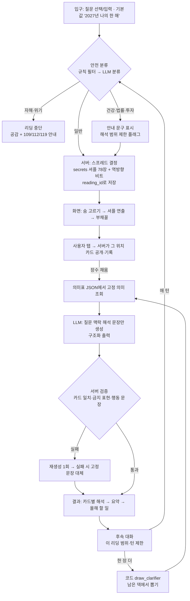
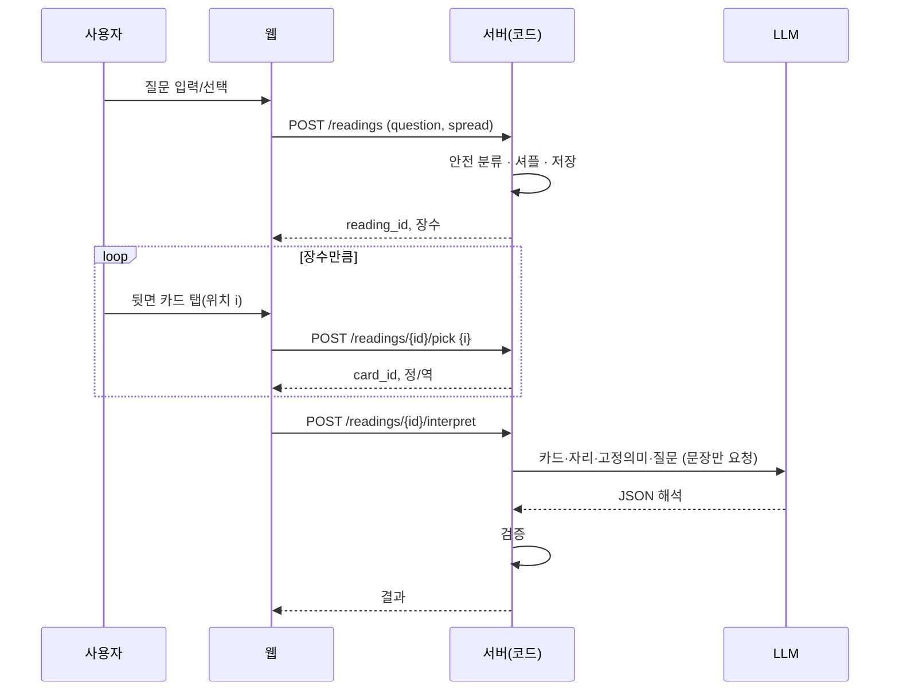

# 03. AI 타로 구조 — 공개 사례, 무작위성, 대화, 안전장치

- 조사일: 2026-10-30 (모든 확인일 동일)
- 전제(사용자 원칙): **카드 뽑기와 카드 의미표는 코드/데이터, LLM은 질문 맥락에 맞춘 해석 문장만.** 이 문서의 설계 제안은 모두 이 원칙을 따른다. "제안"이라고 쓴 부분은 조사 사실이 아니라 우리 판단이다.

---

## 1. 공개 사례 구조

| 사례 | 카드 뽑기 주체 | 의미 데이터 | LLM 역할 | 후속 대화 | 출처 |
|---|---|---|---|---|---|
| msull/emilytarot (Streamlit + GPT, MIT, ★40) | 코드: `random.Random(shuffle_seed)`로 뽑음, 시드는 화면에 보이고 사용자가 바꿀 수 있음(`uuid4().hex` 기본). "내 실물 덱으로 뽑고 이름 입력" 모드도 있음 | 카드 이름 목록만 | 페르소나 'Emily'가 질문을 던지고, 뽑을 장수를 `PULL TAROT CARDS:3` 명령으로 지시 → 코드가 뽑음 → "카드당 2문장 + 전체 이야기" | 예(자유 대화) | https://github.com/msull/emilytarot (`src/utils/messages.py`, `src/streamlit_app.py`) |
| suzakuzhang/tarot-local-test (Flask, 메이저 22장) | 코드(`random`), 엎어둔 3장 중 1장을 사용자가 고름 | `cards_data.json` 고정 의미 | 2층 결과: **고정 의미 + LLM 맞춤 해석**. 말투 프리셋 여러 개 | "카드 정령 모드": 그 카드에 한정된 10분짜리 후속 대화(Gemini) | https://github.com/suzakuzhang/tarot-local-test (`README.md`, `card_spirit_prompt.py`) |
| Trail of Bits `let-fate-decide` (Claude Code 스킬, CC BY-SA 4.0) | 코드: `secrets.randbelow()`로 Fisher-Yates 셔플, 메이저·마이너 따로 섞음, 카드마다 역방향 50% 독립, **엔트로피 비트(>100bit)를 JSON에 기록** | 카드별 .md 파일 78개 | Claude가 의미 파일을 읽고 해석 | 해당 없음 | https://github.com/trailofbits/skills/tree/main/plugins/let-fate-decide (README) |
| n8n 템플릿 6061 (iMessage + GPT + Blooio) | "Draw a card for me" → 가상 뽑기(코드인지 LLM인지 **미확인**). 실물 카드 사진 + 질문 → AI 인식 | 미확인 | "Mystic Tarot Reader" 페르소나 | 메시지 단위 | https://n8n.io/workflows/6061-ai-powered-tarot-readings-via-imessage-with-gpt-and-blooio/ |
| RoxyAPI n8n 점성술 에이전트 템플릿 (MIT) | 외부 API의 tarot 도구 | 외부 API | AI Agent + 메모리 + 도구 호출 | 예 | https://roxyapi.com/templates/n8n-astrology-ai-agent (검색 요약 경유) |
| dev.to "Making Gemini a Tarot Master" (LangChain, 2024-04-01) | 앱이 3장 뒤집기(무작위 방식은 글에 없음) | 크롤링한 타로 자료를 벡터DB(MongoDB Atlas)에 넣고 RAG | 스프레드별 시스템 프롬프트 + 검색 결과로 해석 | 미확인 | https://dev.to/lazypro/making-gemini-a-tarot-master-2j72 |
| 봉봉 타로챗 (국내 상용) | 기사상 "AI가 입력 내용을 바탕으로 카드를 선택"(정확한 방식 미확인) | 미확인 | 캐릭터 '봉신' 공감형 상담 | 예 | https://byline.network/2025/09/9262/ |

### 1-1. 사례에서 배울 점
- **잘한 것**
  - emilytarot: LLM은 "몇 장 뽑을지"만 말하고 **실제 뽑기는 코드**. 시드를 보여줘 재현 가능
  - suzaku: **고정 의미(닻) + 맞춤 해석** 2층. 후속 대화를 "이 카드·이 질문" 범위로 묶고 시간 제한. 프롬프트에 경계 명시: "不神谕化…不说命运注定"(신탁처럼 말하지 않음, 운명 확정 금지), "不给医疗/法律/投资结论"(의료·법률·투자 결론 금지), "每轮最多 1 个追问"(한 턴에 되묻기 1개), 80~180자
  - Trail of Bits: 암호학적 난수 + 엔트로피 기록 → "정말 무작위였나?"에 숫자로 답할 수 있음
- **조심할 것**
  - LLM에게 카드를 고르게 하면 질문 주제에 맞는 카드가 나오는 편향 의심(업체 Jenova 주장, r/tarot 의견 — 01 문서 2-6). 봉봉 타로챗처럼 "AI가 카드 선택"으로 보이는 구조는 피한다
  - RAG(dev.to)는 크롤링 자료 품질·저작권 검증이 없다고 글 스스로 언급하지 않음 → 우리는 RAG 대신 **검수된 78장 JSON을 그대로 프롬프트에 넣는 방식**이 간단하고 안전(제안)

---

## 2. 무작위성 설계

### 2-1. 원칙 (제안)
1. **카드 결정은 서버**에서 암호학적 난수(Python `secrets.SystemRandom`)로 한다. 브라우저 `crypto.getRandomValues`는 연출용으로만. 브라우저 결과를 믿지 않는다(조작 방지, 기록 일관성)
2. Fisher-Yates 셔플 1회로 78장 순서를 정하고, 역방향은 카드마다 독립 확률 p(설정값, 예: 0.5 또는 끄기). 참고: Trusted Tarot는 사용자에게 5%/10%/50%를 고르게 함 — https://www.trustedtarot.com/free-reading/
3. **기록**: `reading_id`, `deck_version`, `meaning_version`, 셔플 결과(78장 순서 + 역방향 비트), 사용자가 탭한 위치, 서버 시각을 저장. 같은 리딩을 다시 열면 같은 카드가 나와야 한다
4. 시드 공개 여부: emilytarot처럼 시드를 보여주면 재현은 쉽지만, 사용자가 시드를 바꿔 "좋은 카드 나올 때까지" 돌릴 수 있다. 우리 서비스에선 **시드 대신 `reading_id`로 다시 보기**만 제공(제안)
5. 다시 뽑기 정책: 같은 질문 재뽑기 허용 여부·횟수는 **제품 결정 사항**(예: "하루 1회 무료", 또는 "새 질문으로만")

### 2-2. "사용자가 직접 고르는" 인터랙션과 공정성
- 방식 A — **사전 셔플 + 위치 선택**: 서버가 78장 순서를 먼저 정해 두고(커밋), 사용자가 부채꼴에서 i번째 뒷면을 탭하면 그 위치의 카드를 공개. 사용자의 선택이 실제 결과를 바꾼다 → "내가 골랐다"가 사실이 됨
- 방식 B — **탭은 연출, 서버가 따로 뽑음**: 탭과 무관하게 서버가 다음 카드를 줌. 통계적으로는 A와 같지만, "내가 고른 것"이 연출일 뿐
- 비교: 둘 다 각 카드가 나올 확률은 1/78로 같다(셔플이 균등하면 위치 선택은 확률을 바꾸지 않음 — 수학적 사실). 차이는 **정직성**. A를 권장(제안)
- 더 강한 공정성(선택): 셔플 결과의 해시를 탭 전에 화면에 보여주고, 리딩 후 원본을 공개해 대조(commit-reveal). 사내 PoC엔 과할 수 있음 — 제품 결정 사항
- 손 셔플 대안: Trusted Tarot는 "매일 실제 덱을 손으로 섞어 올린 순서"를 모든 사용자에게 씀 — 사람 손을 신뢰 근거로 삼는 다른 접근(https://www.trustedtarot.com/)
- 참고: 공정성·사용자 선택 비교를 다룬 독립 연구는 **찾지 못함(미확인)**

### 2-3. 의사 코드
```python
import secrets
rng = secrets.SystemRandom()

def new_reading(spread, reversal_p):
    order = list(range(78))
    rng.shuffle(order)                                   # Fisher-Yates
    reversed_bits = [rng.random() < reversal_p for _ in range(78)]
    return save(order=order, reversed=reversed_bits, spread=spread)

def pick(reading_id, fan_index):                         # 사용자가 탭한 부채꼴 위치
    r = load(reading_id)
    assert fan_index not in r.picked and len(r.picked) < r.spread.size
    card = r.order[fan_index]
    r.picked.append(fan_index)                           # 기록
    return card, r.reversed[fan_index]
```

---

## 3. 대화형 후속 질문 설계 (제안)

1. **첫 해석은 구조화 출력**(아래 5장 스키마)으로 받고 화면에 카드별로 나눠 보여준다
2. 후속 대화는 **이 리딩 범위로 묶는다**(suzaku의 "카드 정령" 방식): 시스템 프롬프트에 뽑힌 카드·자리·정/역·고정 의미·원 질문을 매번 넣는다
3. **새 카드는 LLM이 만들지 않는다.** 사용자가 "한 장 더"를 원하면 코드가 같은 리딩의 남은 덱에서 뽑는 `draw_clarifier` 도구만 허용(도구 호출 결과를 LLM이 해석)
4. 추천 후속 버튼: "이 시기(분기/월) 더 자세히", "이 카드가 일/돈/관계에서는?", "제일 신경 쓸 한 가지는?"
5. 턴 제한(예: 5턴)과 "한 턴에 되묻기 최대 1개", 답변 길이 제한(suzaku 80~180자 참고)
6. 매 응답 끝은 **할 일 한 가지**로 닫기(우리 원칙: 나쁜 카드도 대응 행동으로 마무리)
7. 같은 질문 반복("그래서 붙어요 안 붙어요?")에는 카드 의미 범위에서만 답하고 확정 예언은 하지 않음

---

## 4. 질문 안전장치

### 4-1. 근거
- 타로 업계 윤리: ATA 강령 인용본 — 법률·재정·의료·심리 문제는 자격 있는 전문가와 상담하도록 권한다 — https://luciengagnontarotreader.yolasite.com/the-ata-code-of-ethics.php (ATA 공식 원문은 미확인, 인용본)
- Benebell Wen: 건강·법률 리딩을 피하는 주된 이유는 무면허 의료·법률 행위 금지 법률 때문 — https://benebellwen.com/2017/07/07/ ("On Tarot Reading Ethics, Part I", 2017-07-07)
- AI 위험: 챗봇이 망상 강화·자해와 연결된 사례 보도, 감정 의존 — PBS/The Conversation 2026-05-17 https://www.pbs.org/newshour/arts/more-tarot-readers-are-turning-to-ai-for-advice-another-sign-of-our-growing-reliance-on-chatbots-for-emotional-support
- 아첨(듣고 싶은 말만) 문제 — 요즘IT 2025-01-17 https://yozm.wishket.com/magazine/detail/2938
- 한국 자살예방 상담전화 **109**(2024-01-01부터 1393 등 통합, 24시간, 수신자 부담) — https://www.korea.kr/news/policyNewsView.do?newsId=148921684 , https://www.etoday.co.kr/news/view/2312343

### 4-2. 분류와 처리 (제안 — 판단 조건은 코드/규칙 파일)
| 분류 | 예 | 처리 |
|---|---|---|
| 자해·자살·타해 | "죽고 싶어요", "그 사람 해치면…" | **리딩 중단**. 카드 해석 없이 공감 1문장 + 109 안내(자살), 112/119(긴급). LLM 호출 전에 규칙 필터로 1차 감지, LLM 분류로 2차 확인 |
| 건강·의료 | "암일까요", "수술 잘 될까요", "임신될까요" | 결과 예측 금지. "몸 상태는 의사와 확인"을 먼저 말하고, 카드는 **마음가짐·생활 습관** 쪽으로만 해석 |
| 법률 | "소송 이길까요", "이혼하면 양육권" | 승패 예측 금지. 전문가 상담 안내 + 준비·대응 태도로만 해석 |
| 투자·돈 | "이 주식 오를까요", "코인 사도 돼요" | 종목·가격·매수매도 판단 금지. 한화생명 사내 서비스이므로 금융상품 권유로 읽히지 않게 특히 주의(제안). "돈 관리 습관·결정 기준" 쪽으로만 |
| 제3자 사생활 | "그 사람 지금 누구 만나요?", "동료가 날 싫어하나" | 상대 마음 단정 금지, "내 쪽에서 할 수 있는 것"으로 돌리기(Benebell Wen Part II 주제 — https://benebellwen.com/2017/07/11/on-tarot-reading-ethics-part-ii-third-party-readings-and-onerous-clients/) |
| 죽음·사고 예언 요구 | "내년에 부모님 돌아가시나요" | 예언 금지. 죽음 카드가 나와도 "실제 죽음이 아니다"를 먼저 말함 |
| 일반 | 연애·일·한 해 운세 | 정상 리딩 |

- 출력 쪽 필터(제안): 생성 문장에서 금지 표현("반드시 ~됩니다", "확실히", "사세요/파세요", 병명·진단) 검사 후 걸리면 재생성 또는 기본 문장 대체
- 고지: 첫 화면·결과 하단에 "재미와 자기 성찰용, 의료·법률·투자 결정의 근거가 아님" 한 줄(제안)

---

## 5. 출력 스키마 예시 (LLM 구조화 출력)

LLM 입력에는 **코드가 정한 카드·자리·정/역·고정 의미**를 넣고, LLM은 문장만 채운다. 카드 id는 입력과 같아야 하고 서버가 검증한다.

```json
{
  "reading_id": "r_2027_8f3c...",
  "safety": { "category": "general", "action": "proceed" },
  "cards": [
    {
      "position_key": "q2",
      "position_label": "2분기",
      "card_id": "major_16",
      "orientation": "reversed",
      "image_detail": "번개 맞은 탑에서 사람이 떨어지는 장면이 거꾸로 놓였습니다.",
      "meaning_ref": "major_16.reversed.v1",
      "interpretation": "이직 고민과 이어 보면, 2분기에는 미뤄 온 정리를 더 미루기 어려운 시기로 읽힙니다.",
      "action": "4월 안에 지금 일의 불만 3가지를 적고, 고칠 수 있는 것과 없는 것을 나눠 보세요.",
      "tone": "challenging"
    }
  ],
  "summary": "올해는 상반기 정리, 하반기 확장의 흐름입니다.",
  "year_actions": ["...", "...", "..."],
  "follow_up_suggestions": ["3분기를 더 자세히", "이 카드가 돈 문제에서는?"],
  "disclaimer_key": "tarot_general_v1"
}
```

서버 검증(제안): `card_id`/`orientation`이 서버 기록과 일치, `cards` 수 = 스프레드 장수, `tone=challenging`이면 `action` 필수, 금지 표현 검사, 길이 제한.

---

## 6. 흐름도





---

## 7. 미확인
- n8n 6061 템플릿의 카드 뽑기가 코드인지 LLM인지
- 봉봉 타로챗의 카드 선택 방식
- Ink-Osier/ai-tarot 등 다른 공개 저장소의 내부 구조(목록만 확인, 코드 미열람)
- ATA 강령 공식 원문
- 사용자 직접 선택 vs 알고리즘 뽑기의 체감 공정성에 관한 독립 연구
